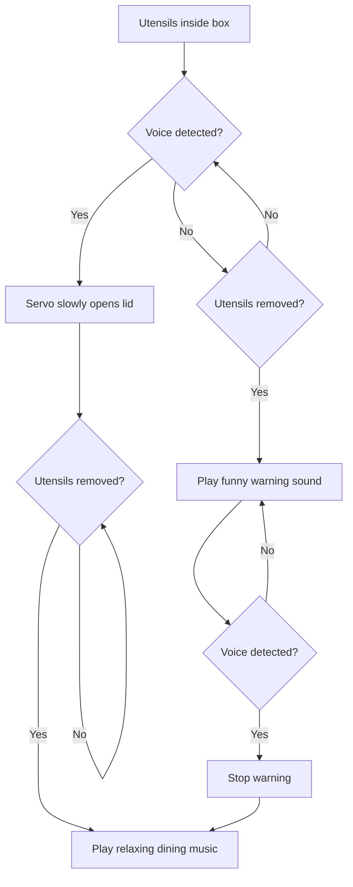

# Ph-UI!!!


## Lab Overview  
Members: Flora Zhang zz979

Project name: Itadakimasu Box


For lab this week, we focus on both sensing and actuation, bringing new modes of input and output into your devices, while also prototyping the physical structure and overall look of the device. You will consider how the physical form supports sensing and actuation, and how these elements come together to shape the interaction and aesthetics of the device.


## Part 1 Lab Preparation

<details>
<summary><strong> Part A  Capacitive Sensing, a.k.a. Human-Twizzler Interaction </strong></summary> 

We want to introduce you to the [capacitive sensor](https://learn.adafruit.com/adafruit-mpr121-gator) in your kit. It's one of the most flexible input devices we are able to provide. At boot, it measures the capacitance on each of the 12 contacts. Whenever that capacitance changes, it considers it a user touch. You can attach any conductive material. In your kit, you have copper tape that will work well, but don't limit yourself! In the example below, we use Twizzlers--you should pick your own objects.


<p float="left">

 
</p>

Plug in the capacitive sensor board with the QWIIC connector. Connect your Twizzlers with either the copper tape or the alligator clips (the clips work better). Install the latest requirements from your working virtual environment:

These Twizzlers are connected to pads 6 and 10. When you run the code and touch a Twizzler, the terminal will print out the following

```
(circuitpython) pi@ixe00:~/Interactive-Lab-Hub/Lab 4 $ python cap_test.py 
Twizzler 10 touched!
Twizzler 6 touched!
```
</details>

<details>
<summary><strong> Part B  More sensors </strong></summary>
 Light/Proximity/Gesture sensor (APDS-9960)

We here want you to get to know this awesome sensor [Adafruit APDS-9960](https://www.adafruit.com/product/3595). It is capable of sensing proximity, light (also RGB), and gesture! 
 

 

Connect it to your pi with Qwiic connector and try running the three example scripts individually to see what the sensor is capable of doing!

```
(circuitpython) pi@ixe00:~/Interactive-Lab-Hub/Lab 4 $ python proximity_test.py
...
(circuitpython) pi@ixe00:~/Interactive-Lab-Hub/Lab 4 $ python gesture_test.py
...
(circuitpython) pi@ixe00:~/Interactive-Lab-Hub/Lab 4 $ python color_test.py
...
```

You can go the the [Adafruit GitHub Page](https://github.com/adafruit/Adafruit_CircuitPython_APDS9960) to see more examples for this sensor!

#### Rotary Encoder 

A rotary encoder is an electro-mechanical device that converts the angular position to analog or digital output signals. The [Adafruit rotary encoder](https://www.adafruit.com/product/4991#technical-details) we ordered for you came pre-soldered, so you do NOT need to solder anything.
<p float="left">

   


</p>

Connect it to your pi with Qwiic connector and try running the example script, it comes with an additional button which might be useful for your design!

```
(circuitpython) pi@ixe00:~/Interactive-Lab-Hub/Lab 4 $ python encoder_test.py
```

You can go to the [Adafruit Learn Page](https://learn.adafruit.com/adafruit-i2c-qt-rotary-encoder/python-circuitpython) to learn more about the sensor! The sensor actually comes with an LED (neo pixel): Can you try lighting it up? 

#### Joystick 


A [joystick](https://www.sparkfun.com/products/15168) can be used to sense and report the input of the stick for it pivoting angle or direction. It also comes with a button input!

<p float="left">

</p>

Connect it to your pi with Qwiic connector and try running the example script to see what it can do!

```
(circuitpython) pi@ixe00:~/Interactive-Lab-Hub/Lab 4 $ python joystick_test.py
```

You can go to the [SparkFun GitHub Page](https://github.com/sparkfun/Qwiic_Joystick_Py) to learn more about the sensor!

#### Distance Sensor


Earlier we have asked you to play with the proximity sensor, which is able to sense objects within a short distance. Here, we offer [Sparkfun Proximity Sensor Breakout](https://www.sparkfun.com/products/15177), With the ability to detect objects up to 20cm away.

<p float="left">


</p>

Connect it to your pi with Qwiic connector and try running the example script to see how it works!

```
(circuitpython) pi@ixe00:~/Interactive-Lab-Hub/Lab 4 $ python qwiic_distance.py
```

You can go to the [SparkFun GitHub Page](https://github.com/sparkfun/Qwiic_Proximity_Py) to learn more about the sensor and see other examples

---
</details>

<details>
<summary><strong> Part C Servo Actuation </strong></summary>
Now that you have explored several forms of sensing, add physical output by learning to control a servo motor. Complete the Servo pHAT setup and basic servo test before beginning your interaction design.

### Servo Control with SparkFun Servo pHAT
For this lab, you will use the **SparkFun Servo pHAT** to control a micro servo (such as the Miuzei MS18 or similar 9g servo). The Servo pHAT stacks directly on top of the Adafruit Mini PiTFT (135×240) display without pin conflicts:
- The Mini PiTFT uses SPI (GPIO22, 23, 24, 25) for display and buttons ([SPI pinout](https://pinout.xyz/pinout/spi)).
- The Servo pHAT uses I²C (GPIO2 & 3) for the PCA9685 servo driver ([I2C pinout](https://pinout.xyz/pinout/i2c)).
- Since SPI and I²C are separate buses, you can use both boards together.
**⚡ Power:**
- Plug a USB-C cable into the Servo pHAT to provide enough current for the servos. The Pi itself should still be powered by its own USB-C supply. Do NOT power servos from the Pi’s 5V rail.

<p align="center">
    
</p>

**Basic Python Example:**
We provide a simple example script: `Lab 4/pi_servo_hat_test.py` (requires the `pi_servo_hat` Python package).
Run the example:
```
python pi_servo_hat_test.py
```
For more details and advanced usage, see the [official SparkFun Servo pHAT documentation](https://learn.sparkfun.com/tutorials/pi-servo-phat-v2-hookup-guide/all#resources-and-going-further).
A servo motor is a rotary actuator that allows for precise control of angular position. The position is set by the width of an electrical pulse (PWM). You can read [this Adafruit guide](https://learn.adafruit.com/adafruit-arduino-lesson-14-servo-motors/servo-motors) to learn more about how servos work.

---
</details>
<details>
<summary><strong> Part D Physical Interaction Design </strong></summary>

**Feast Automata:** build a device that **transforms ordinary dining rituals into playful physical interactions.** Begin with a familiar experience around eating, drinking, cooking, serving, or sharing food, and explore how sensing and actuation might augment, exaggerate, automate, or reinterpret your dining experience.

In this part, use the sensing techniques from Parts A–B and the servo actuation from Part C to develop a physical interaction.

#### Physical considerations for sensing

Sensors need to be positioned in specific locations or orientations to make them useful for an application. Choose a sensor that fits the dining interaction you want to explore. For example, a distance sensor could detect when a cup is placed on a coaster; where the sensor is positioned determines what it can reliably detect.

Think about how the larger object needs to be shaped so the sensor can work reliably, where the actuator needs to sit, what moves, and how a person encounters the interaction.

#### Physical Form and Housing

Think about how your sensor, actuator, and electronics are physically arranged within your prototype. Consider where components need to be placed, what parts move, how the device is supported or enclosed, and how the overall form and aesthetics shape the interaction.

Use cardboard, paper, found objects, or other low-fidelity materials to quickly prototype the physical structure before refining your final design.

#### Optional Display Feedback: Qwiic OLED

Your kit includes these [SparkFun Qwiic OLED screens](https://www.sparkfun.com/products/17153). These use less power than the MiniTFTs you have mounted on the GPIO pins of the Pi, but, more importantly, they can be more flexibly mounted elsewhere on your physical interface. The way you program this display is almost identical to the way you program a  Pi display. Take a look at `oled_test.py` and some more of the [Adafruit examples](https://github.com/adafruit/Adafruit_CircuitPython_SSD1306/tree/master/examples).

<p float="left">


</p>
</details>

### Itadakimasu Box
My *Itadakimasu Box* is inspired by the Japanese tradition of putting one's hands together and saying "Itadakimasu" before eating. A proximity sensor will be attached to a wearable napkin at chest level to detect the hand gesture, while a microphone recognizes the spoken phrase. A servo motor will be installed at the back of the utensil box to control the lid, which opens only after both actions are completed. A light sensor inside the box will detect unauthorized opening and trigger an unusual sound effect. The electronic components will be hidden inside or beneath the box, keeping the design clean. The box will feature a minimalist, Japanese-inspired aesthetic to emphasize the sense of ritual before a meal.

**\*\*\*Draw 5 sketches that explore different physical arrangements for your sensing and actuation.\*\*\***


<p align="center">
  
  
  
  
  
</p>


**\*\*\*What questions do these sketches raise? What do you need to physically prototype to answer them?\*\*\***

These sketches raise several questions about the reliability of the sensors and the physical design. First, can the proximity sensor accurately detect when the user's hands are together without being triggered by other movements? Second, how should the servo motor be positioned to open the utensil box smoothly? Third, can the light sensor distinguish between normal opening and forced opening?

To answer these questions, I need to prototype the sensor placement on the wearable napkin and test different distances and angles. I also need to build a simple cardboard box to experiment with the servo mechanism and lid movement. Finally, I will test the light sensor inside the box to see whether it can reliably detect unauthorized opening and trigger sound feedback.

**\*\*\*Pick one design to prototype and explain why.\*\*\***

I would like to prototype the servo-controlled utensil box first because it is the easiest to build and test physically. I can use cardboard to create a simple box and attach a servo motor to control the lid. This will help me figure out the best position for the motor, the opening angle, and whether the lid can move smoothly. Once the mechanism works reliably, I can connect it to the proximity sensor and voice recognition system to complete the interaction.

**\*\*\*Document your rough prototype with photos and/or video.\*\*\***

[VIDEO](https://drive.google.com/file/d/1CD3hB3yAuTPhOCCj3cPDl1wWDBbu1MM9/view?usp=sharing)

## Part 2

Following exploration and reflection from Part 1, complete the "looks like," "works like" and "acts like" prototypes for your design, reiterated below.

---

### Part E

#### Build & Integrate: Sensing + Actuation


<details>
<summary><strong>Optional Extensions </strong></summary>

The following examples are optional resources if you want to add more inputs or outputs to your prototype.

##### Using Multiple Qwiic Buttons: Changing I2C Address (Physically & Digitally)

If you want to use more than one Qwiic Button in your project, you must give each button a unique I2C address. There are two ways to do this:

##### 1. Physically: Soldering Address Jumpers

On the back of the Qwiic Button, you'll find four solder jumpers labeled A0, A1, A2, and A3. By bridging these with solder, you change the I2C address. Only one button on the chain can use the default address (0x6F).

**Address Table:**

| A3 | A2 | A1 | A0 | Address (hex) |
|----|----|----|----|---------------|
|  0 |  0 |  0 |  0 |    0x6F       |
|  0 |  0 |  0 |  1 |    0x6E       |
|  0 |  0 |  1 |  0 |    0x6D       |
|  0 |  0 |  1 |  1 |    0x6C       |
|  0 |  1 |  0 |  0 |    0x6B       |
|  0 |  1 |  0 |  1 |    0x6A       |
|  0 |  1 |  1 |  0 |    0x69       |
|  0 |  1 |  1 |  1 |    0x68       |
|  1 |  0 |  0 |  0 |    0x67       |
| ...| ...| ...| ... |     ...      |

For example, if you solder A0 closed (leave A1, A2, A3 open), the address becomes 0x6E.

**Soldering Tips:**
- Use a small amount of solder to bridge the pads for the jumper you want to close.
- Only one jumper needs to be closed for each address change (see table above).
- Power cycle the button after changing the jumper.

##### 2. Digitally: Using Software to Change Address

You can also change the address in software (temporarily or permanently) using the example script `qwiic_button_ex6_changeI2CAddress.py` in the Lab 4 folder. This is useful if you want to reassign addresses without soldering.

Run the script and follow the prompts:
```bash
python qwiic_button_ex6_changeI2CAddress.py
```
Enter the new address (e.g., 5B for 0x5B) when prompted. Power cycle the button after changing the address.

**Note:** The software method is less foolproof and you need to make sure to keep track of which button has which address!


##### Using Multiple Buttons in Code

After setting unique addresses, you can use multiple buttons in your script. See these example scripts in the Lab 4 folder:

- **`qwiic_1_button.py`**: Basic example for reading a single Qwiic Button (default address 0x6F). Run with:
	```bash
	python qwiic_1_button.py
	```

- **`qwiic_button_led_demo.py`**: Demonstrates using two Qwiic Buttons at different addresses (e.g., 0x6F and 0x6E) and controlling their LEDs. Button 1 toggles its own LED; Button 2 toggles both LEDs. Run with:
	```bash
	python qwiic_button_led_demo.py
	```

Here is a minimal code example for two buttons:
```python
import qwiic_button

# Default button (0x6F)
button1 = qwiic_button.QwiicButton()
# Button with A0 soldered (0x6E)
button2 = qwiic_button.QwiicButton(0x6E)

button1.begin()
button2.begin()

while True:
		if button1.is_button_pressed():
				print("Button 1 pressed!")
		if button2.is_button_pressed():
				print("Button 2 pressed!")
```

For more details, see the [Qwiic Button Hookup Guide](https://learn.sparkfun.com/tutorials/qwiic-button-hookup-guide/all#i2c-address).

---

##### PCF8574 GPIO Expander: Add More Pins Over I²C

Sometimes your Pi’s header GPIO pins are already full (e.g., with a display or HAT). That’s where an I²C GPIO expander comes in handy.

We use the Adafruit PCF8574 I²C GPIO Expander, which gives you 8 extra digital pins over I²C. It’s a great way to prototype with LEDs, buttons, or other components on the breadboard without worrying about pin conflicts—similar to how Arduino users often expand their pinouts when prototyping physical interactions.

**Why is this useful?**
- You only need two wires (I²C: SDA + SCL) to unlock 8 extra GPIOs.
- It integrates smoothly with CircuitPython and Blinka.
- It allows a clean prototyping workflow when the Pi’s 40-pin header is already occupied by displays, HATs, or sensors.
- Makes breadboard setups feel more like an Arduino-style prototyping environment where it’s easy to wire up interaction elements.

**Demo Script:** `Lab 4/gpio_expander.py`

<p align="center">
    
</p>

We connected 8 LEDs (through 220 Ω resistors) to the expander and ran a little light show. The script cycles through three patterns:
- Chase (one LED at a time, left to right)
- Knight Rider (back-and-forth sweep)
- Disco (random blink chaos)

Every few runs, the script swaps to the next pattern automatically:
```bash
python gpio_expander.py
```

This is a playful way to visualize how the expander works, but the same technique applies if you wanted to prototype buttons, switches, or other interaction elements. It’s a lightweight, flexible addition to your prototyping toolkit.

</details>

### Part F

### Final Documentation

#### System Overview

*Itadakimasu Box* transforms a traditional Japanese pre-meal ritual into an interactive dining experience. The prototype uses a USB microphone to detect the user's voice, a SparkFun VCNL4040 proximity sensor to detect whether utensils are inside the box, and a servo motor to control the lid. A USB speaker provides different audio feedback depending on whether the user follows or skips the ritual.

The system combines sensing, physical movement, and sound to create a playful dining experience.

#### Interaction Flow



**Looks Like**

The prototype is a utensil box with a servo-controlled lid. A VCNL4040 proximity sensor is positioned inside the box to detect the presence of utensils, while the servo motor is attached to the lid mechanism. The Raspberry Pi and electronic connections control the system, and a USB microphone and speaker provide voice input and audio feedback.

**Works Like**

The system uses sound detection to initiate the dining ritual. When the microphone detects a sound above the threshold, the servo slowly opens the lid. The proximity sensor then detects when the utensils are removed, triggering relaxing background music. If the utensils are removed before the ritual is completed, the speaker plays a funny reminder instead. The user can then speak to complete the ritual and activate the normal music.

**Acts Like**

The device behaves like a playful dining companion that encourages the user to perform a ritual before eating. Instead of simply storing utensils, it responds to the user's actions through movement and sound. The slow opening movement creates anticipation, while the humorous reminder makes skipping the ritual a playful part of the experience.


#### Code

The final prototype integrates voice detection,
proximity sensing, servo actuation, and audio feedback.

[View the Python code](./itadakimasu_box.py)


